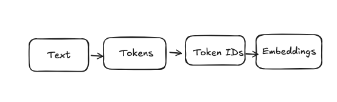

# LLMs for Infrastructure Engineers

As an infrastructure engineer, I've always been curious about how LLM serving and inference work behind the scenes. The books I've read cover transformer architecture and how to build an LLM from scratch, but I don't use that knowledge day-to-day as an infrastructure engineer. Even though it helps to understand how transformer architecture and attention mechanisms work, I'm not inclined toward that. I plan to write this blog to cover the basics an Infrastructure Engineer needs to understand LLMs, focusing on the aspects that are challenging from an infrastructure point of view.

### What are tokens?

LLMs don't read the text the way we do. Before the model sees anything, the text is split into small **chunks** called **tokens**, and each chunk is mapped to a number called a token ID. The model only works with sequences of these IDs, and it also generates its output one token at a time.

Tokens are not always whole words. On average, one token covers about 4 characters of English text. Take "An Apple a day keeps the doctor away." The model sees 9 tokens: each word, with its leading space attached, plus the period. Now take "That was an unbelievable shot by the batsman." Here, a long or uncommon word gets broken into pieces. "unbelievable" and "batsman" each split into multiple tokens, so a sentence of 8 words ends up as more than 8 tokens.

Here is an example using the OpenAI tokenizer called tiktoken that takes words and converts them into token IDs. The entire list of tokens a tokenizer knows is called its vocabulary, and each token has a fixed ID.

```python
import tiktoken

enc = tiktoken.get_encoding("cl100k_base")

texts = [
    "An Apple a day keeps the doctor away.",
    "That was an unbelievable shot by the batsman.",
]

for text in texts:
    ids = enc.encode(text)
    print(f"Text: {text}")
    print(f"Characters: {len(text)}, Tokens: {len(ids)}, Chars per token: {len(text) / len(ids):.2f}")
    for token_id in ids:
        print(f"  {token_id:>7}  {enc.decode([token_id])!r}")
    print()
```

```
Text: An Apple a day keeps the doctor away.
Characters: 37, Tokens: 9, Chars per token: 4.11
     2127  'An'
     8325  ' Apple'
      264  ' a'
     1938  ' day'
    13912  ' keeps'
      279  ' the'
    10896  ' doctor'
     3201  ' away'
       13  '.'

Text: That was an unbelievable shot by the batsman.
Characters: 45, Tokens: 10, Chars per token: 4.50
     4897  'That'
      574  ' was'
      459  ' an'
    52229  ' unbelievable'
     6689  ' shot'
      555  ' by'
      279  ' the'
    43308  ' bats'
     1543  'man'
       13  '.'
```

### Why should an Infra engineer care?

Tokens are units that almost everything is measured in:

1. Context Window Limits
2. KV cache memory
3. Throughput (tokens per second)
4. Time to first token
5. Billing.



### What are embeddings?

Token IDs are numbers that carry no meaning by themselves. The model needs something richer to work with, so it keeps a table with one row for every token in its vocabulary. Each row is a list of numbers called a vector, and the token ID tells the model which row to pick. This vector is the token embedding.

These vectors are learned during training, and tokens that are used in similar ways end up with similar vectors. You can think of each vector as a point in a space with thousands of dimensions, where `king` and `queen` sit close together and `king` and `apple` sit far apart.

The embedding table is real GPU memory. Its size is `vocabulary size × embedding dimension × bytes per number`. For a model with a 128,000-token vocabulary and 4,096 dimensions in FP16, that's about 1 GB. It's still a small slice of the total, though. A 7B to 8B model in FP16 has around 14 to 16 GB of weights, and most of that sits in the transformer layers.

The embedding is only the starting point. The vectors then pass through the transformer layers, which update them using the surrounding context. At the end, the output layer takes the model's final vector and turns it into a score for every token in the vocabulary, so the model can pick the next token. Unless the model reuses the embedding weights (tied embeddings), the output layer has its own matrix of the same size, which adds another 1 GB

Here is a code example.

```python
from transformers import AutoTokenizer, AutoModelForCausalLM

name = "gpt2"
tok = AutoTokenizer.from_pretrained(name)
model = AutoModelForCausalLM.from_pretrained(name)

emb = model.get_input_embeddings()
print("Embedding table shape:", tuple(emb.weight.shape))  # (vocab_size, hidden_size)

text = "An Apple a day keeps the doctor away."
ids = tok.encode(text)

for token_id in ids:
    row = emb.weight[token_id]
    print(f"{token_id:>6}  {tok.decode([token_id])!r:>10}  length={row.shape[0]}  first 3: {row[:3].tolist()}")

size_mb = emb.weight.numel() * emb.weight.element_size() / 1e6
print(f"Table size: {size_mb:.0f} MB")

# Is the output layer a separate matrix, or does it reuse the table?
lm_head = model.get_output_embeddings()
print("Tied embeddings:", lm_head.weight.data_ptr() == emb.weight.data_ptr())
```

```
Embedding table shape: (50257, 768)
  2025        'An'  length=768  first 3: [-0.03234691545367241, -0.09260057657957077, 0.08656724542379379]
  4196    ' Apple'  length=768  first 3: [0.2261935919523239, -0.18272313475608826, 0.2619520425796509]
   257        ' a'  length=768  first 3: [-0.050628889352083206, 0.005635065026581287, 0.04705275595188141]
  1110      ' day'  length=768  first 3: [-0.13789939880371094, -0.02936367131769657, -0.002554020145907998]
  7622    ' keeps'  length=768  first 3: [0.14330673217773438, 0.09142573177814484, 0.12775348126888275]
   262      ' the'  length=768  first 3: [-0.03930363804101944, 0.005014663562178612, 0.04211645573377609]
  6253   ' doctor'  length=768  first 3: [0.10683063417673111, -0.2339390367269516, 0.18830624222755432]
  1497     ' away'  length=768  first 3: [-0.10961391031742096, -0.10752373188734055, 0.025184404104948044]
    13         '.'  length=768  first 3: [0.046641141176223755, -0.011302350088953972, 0.028327781707048416]
Table size: 154 MB
Tied embeddings: True
```

### Model Inference:

Now we understand what tokens and embeddings are. Next, let's walk through what happens when you send a prompt to an LLM and it generates a response. Running a trained model to produce output like this is called inference, as opposed to training, which is how the model learned its weights in the first place.

Model Inference has two phases:

1. Prefill: The model reads your whole prompt and produces the first output token
2. Decode: the model generates the rest of the response one token at a time, feeding each token back in to produce the next. The decode phase continues till we reach EOS(end of sequence) or when context limit is reached.